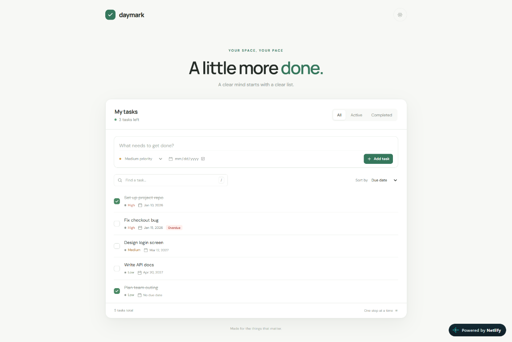
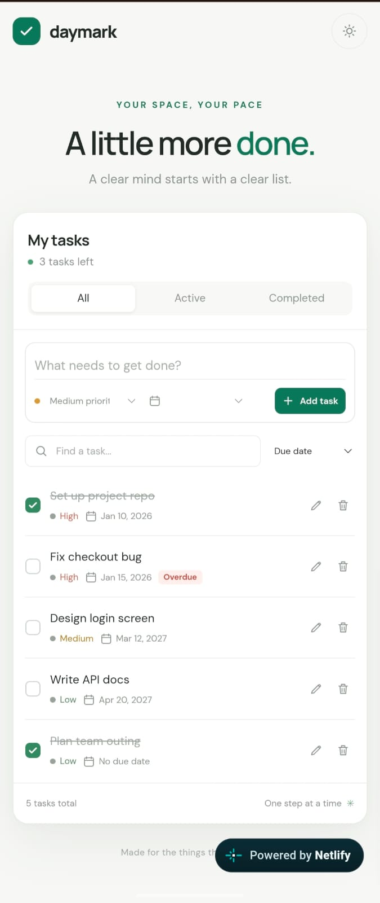

# Daymark — React Task Manager

A responsive, one-page task manager built for the Frontend React Intern Assessment. Daymark lets users add, edit, complete, delete, search, filter, and sort tasks.

Built with **React, Vite, JavaScript, and plain CSS**. It uses React Hooks and browser localStorage for state and persistence. No backend, Redux, or UI component library is used.

## Live Demo

[Open Daymark on Netlify](https://dancing-gumdrop-4a6217.netlify.app)

## Screenshots

### Desktop



### Mobile



## Technologies

- React function components and Hooks
- Vite
- JavaScript (ES modules)
- Plain CSS with responsive layout and light/dark themes
- localStorage for browser-local persistence
- Vitest and React Testing Library
- Oxlint

## Features

### Assessment requirements

- Loads starter tasks from `public/tasks.json` on first use, with loading, error, and retry states.
- Saves task changes in localStorage and loads saved tasks on later visits.
- Adds tasks with a required title, Low/Medium/High priority, and optional due date. Enter submits.
- Completes tasks with a checkbox and strikes through completed titles.
- Edits titles in place; Enter saves, Escape cancels, and blank titles are rejected.
- Confirms before deleting a task.
- Filters by All, Active, and Completed and displays the remaining-task count.
- Searches titles case-insensitively while respecting the selected filter.
- Sorts by due date (soonest first, no date last) or priority (High to Low).
- Shows an Overdue label for incomplete tasks past their due date.
- Supports phone and desktop layouts.

### Additional features

- Offers Undo for five seconds after a confirmed deletion.
- Includes a light/dark theme toggle that remembers the selected theme.
- Uses labeled inputs, native buttons, keyboard controls, screen-reader labels, and visible focus indicators.
- Includes unit tests for task logic and component tests for user interactions.

## Getting started

### Requirements

- Node.js 20.19+ or 22.12+
- npm

### Install and run

```sh
git clone https://github.com/dudekulasohel/Task-Manager-App.git
cd Task-Manager-App
npm install
npm run dev
```

Open the local URL printed by Vite.

## Commands

| Command | Description |
| --- | --- |
| `npm run dev` | Start the development server. |
| `npm test` | Run Vitest and React Testing Library tests. |
| `npm run lint` | Run Oxlint checks. |
| `npm run build` | Create the production build in `dist/`. |
| `npm run preview` | Preview the production build locally. |

## Starter data verification

With no saved task list, the assessment starter data should show:

- **5 tasks total**
- **3 tasks left**
- **Only “Fix checkout bug” is overdue** (based on the current local date).
- Default due-date order in the All tab:
  1. Set up project repo
  2. Fix checkout bug
  3. Design login screen
  4. Write API docs
  5. Plan team outing

The completed task remains visible in All. Tasks without a due date sort last.

## Testing

Run all project checks:

```sh
npm test
npm run lint
npm run build
```

Automated tests cover task validation, filtering and search, sorting, overdue rules, loading and retry, localStorage behavior, task interactions, deletion confirmation, Undo restoration and timeout, and theme persistence.

For manual browser testing, try adding, editing, completing, deleting, filtering, searching, and sorting tasks. Check the five-second Undo, reload to verify persistence, and inspect the layout at 375px and desktop widths.

## Assumptions and limitations

- Starter tasks load only when there is no saved task list. Remove the `task-manager-tasks` localStorage entry and refresh to restore the starter data.
- A task is overdue only when it is incomplete and its due date is earlier than the user's local current date. A task due today is not overdue.
- Due dates use the `YYYY-MM-DD` calendar-date format. Tasks without dates sort last; tasks with equal priority are ordered by due date.
- Tasks and the theme preference are stored only in the current browser. There is no account, backend, cloud backup, or cross-device synchronization.
- A pending Undo action lasts five seconds and does not survive a page reload.
- Automated UI tests run in jsdom; they complement manual testing in a real browser and on physical devices.
- No known required feature is currently broken.

## Estimated effort

Approximately **3–4 hours** for implementation, testing, and documentation. This is a retrospective estimate, not a time-tracked measurement.
